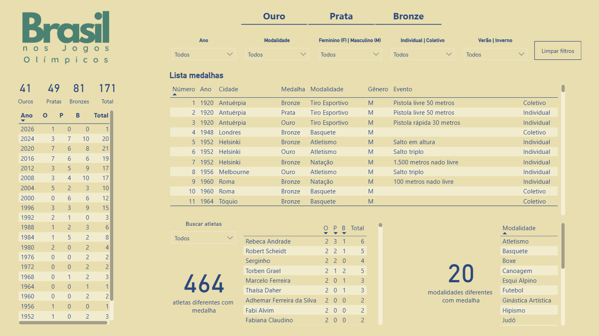
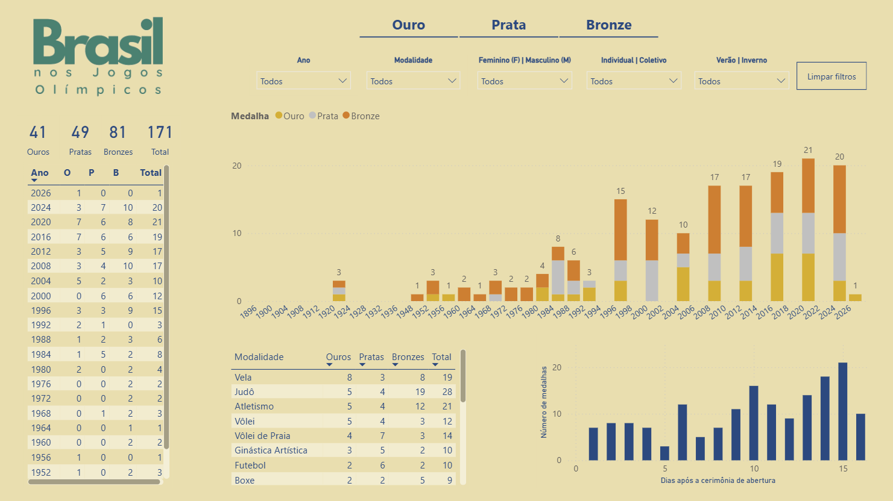
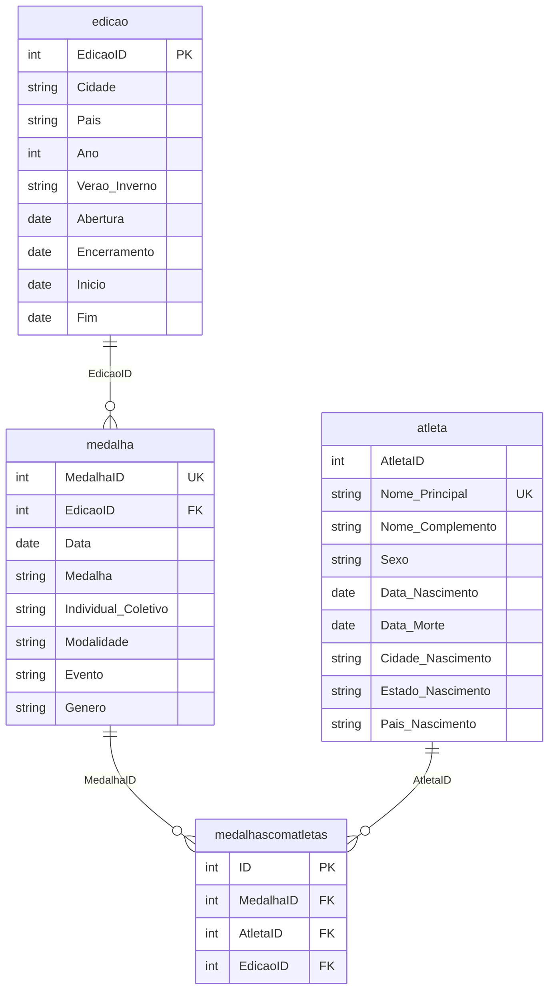

# Brasil Olímpico 🇧🇷

Projeto de análise e visualização de dados das medalhas olímpicas, com foco no desempenho do Brasil ao longo da história dos Jogos. Desenvolvido com SQL, Power BI e modelagem de dados, permite explorar os resultados brasileiros por edição, modalidade e atleta, identificando padrões e acompanhando a evolução do país nas competições.

> **English:** Data analysis and visualization project on Olympic medals, focused on Brazil's performance throughout the history of the Games. Built with SQL, Power BI and data modeling, it lets you explore Brazilian results by edition, sport and athlete, identifying patterns and tracking the country's progress in the competitions. The report is in Portuguese

**[Clique aqui para acessar o relatório no Power BI](https://app.powerbi.com/view?r=eyJrIjoiYWJjMzM5NDctZTkwOC00Y2I5LTk4OWYtMmFhOTViY2JlNDlhIiwidCI6ImFmNmE0MmI1LWJkMGUtNDUwNS1iMDdmLWY5MTdiMGNlMmYzZCJ9)**

## Visão geral do relatório

O relatório tem quatro páginas. Em todas elas existem os filtros no topo (ano, modalidade, feminino/masculino, individual/coletivo e verão/inverno, com o botão "Limpar filtros"), os botões Ouro, Prata e Bronze atualizam os visuais, e a tabela de medalhas por edição aparece à esquerda.

- **Lista de medalhas**: medalhas em ordem cronológica, com ano, cidade, tipo de medalha, modalidade, gênero, evento e se foi individual ou coletiva. Inclui busca por atleta, ranking de medalhas por atleta e o total de modalidades com medalha.
- **Evolução**: medalhas por edição, separadas em ouro, prata e bronze, quadro de medalhas por modalidade e distribuição das medalhas por dias após a cerimônia de abertura.
- **Locais de nascimento**: mapa e tabela por estado de nascimento dos medalhistas brasileiros, lista de atletas por modalidade e medalhistas nascidos fora do Brasil.
- **Idade e gênero**: idade dos atletas no momento da medalha (tabela e histograma) e medalhas por gênero ao longo das edições.

## Objetivos

- Organizar dados históricos das medalhas olímpicas brasileiras em um banco de dados relacional.
- Analisar a evolução do desempenho do Brasil ao longo das edições dos Jogos Olímpicos.
- Comparar a distribuição de medalhas de ouro, prata e bronze entre modalidades e edições.
- Identificar os atletas brasileiros com maior número de medalhas.
- Desenvolver visualizações interativas para facilitar a análise e a interpretação dos dados.

## Tecnologias utilizadas

- **SQL**: consulta, organização e análise dos dados em um banco de dados relacional.
- **MySQL**: criação e modelagem do banco de dados, consultas e views.
- **SQL Server**: armazenamento e gerenciamento dos dados usados pelo relatório (o banco foi migrado do MySQL).
- **Power BI**: modelagem analítica e desenvolvimento de relatórios interativos.
- **DAX**: criação de medidas e cálculos para as análises e visualizações do relatório.

## Banco de dados e consultas SQL

O banco de dados foi estruturado para relacionar informações sobre as edições olímpicas, as medalhas e os atletas brasileiros medalhistas.

As tabelas são:

- `atleta`: informações cadastrais e biográficas dos atletas medalhistas.
- `edicao`: informações sobre as edições dos Jogos Olímpicos, incluindo cidade, país e ano.
- `medalha`: informações sobre as medalhas, como tipo, modalidade, evento e gênero.
- `medalhascomatletas`: tabela de relacionamento entre medalhas e atletas.

As relações entre as tabelas são feitas pelos campos de identificação (`EdicaoID`, `MedalhaID` e `AtletaID`). Uma medalha de esporte coletivo aparece uma vez na tabela `medalha` e uma vez para cada atleta em `medalhascomatletas`.

O projeto também inclui consultas SQL para exploração dos dados e criação de views analíticas. Essas consultas utilizam recursos como **CTEs (Common Table Expressions), funções de agregação, junções entre tabelas, e views** para consolidar os resultados por modalidade, edição olímpica e atleta.

## Dados e fontes

Os dados foram coletados e organizados de forma independente, com consulta a diferentes fontes para reunir e conferir informações históricas. Os dados biográficos dos atletas, incluindo datas de nascimento, foram verificados por meio do cruzamento de fontes sempre que necessário.

As principais referências utilizadas são:

- [Time Brasil](https://www.cob.org.br/time-brasil)
- [Olympedia](https://www.olympedia.org/)

## Estrutura do projeto

- `dump_jogosolimpicos.sql`: dump do banco de dados (MySQL), contendo sua estrutura e os dados armazenados.
- `script_jogosolimpicos.sql`: consultas SQL exploratórias (MySQL) e criação de views para resumir as medalhas por modalidade, edição olímpica e atleta.
- `.pbip-files/`: arquivos do projeto Power BI, incluindo o relatório e o modelo semântico.
- `images/`: capturas de tela do relatório usadas neste README.

